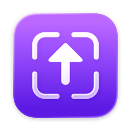
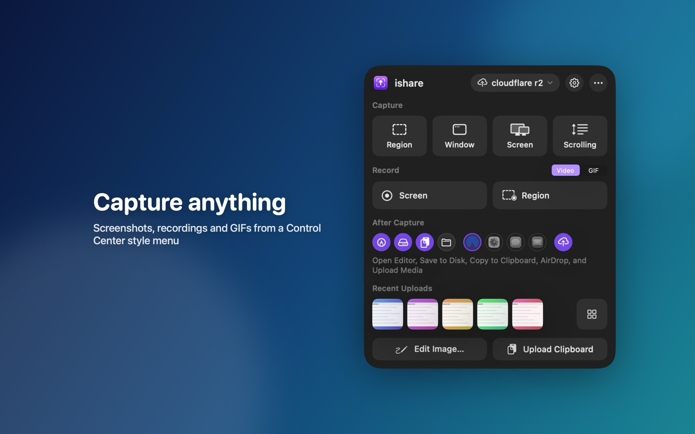
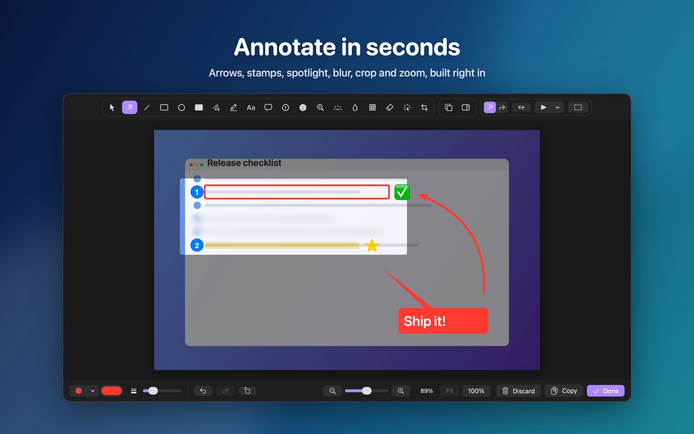
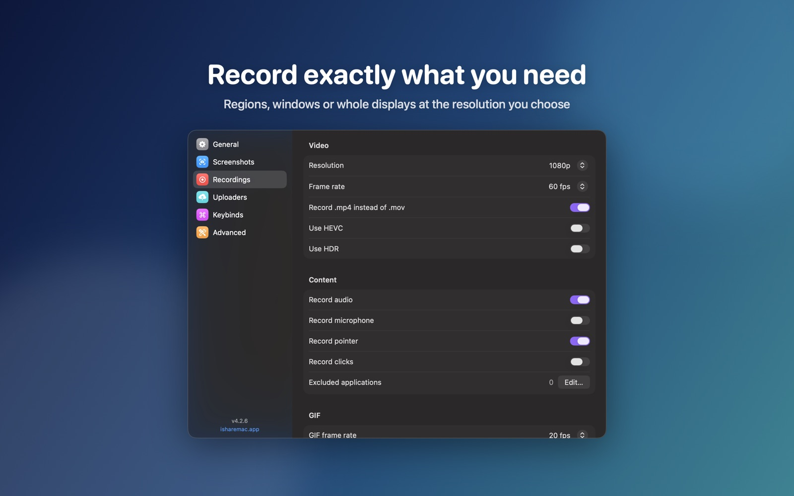
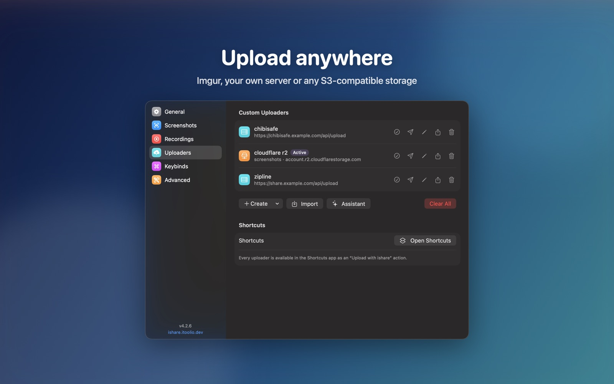
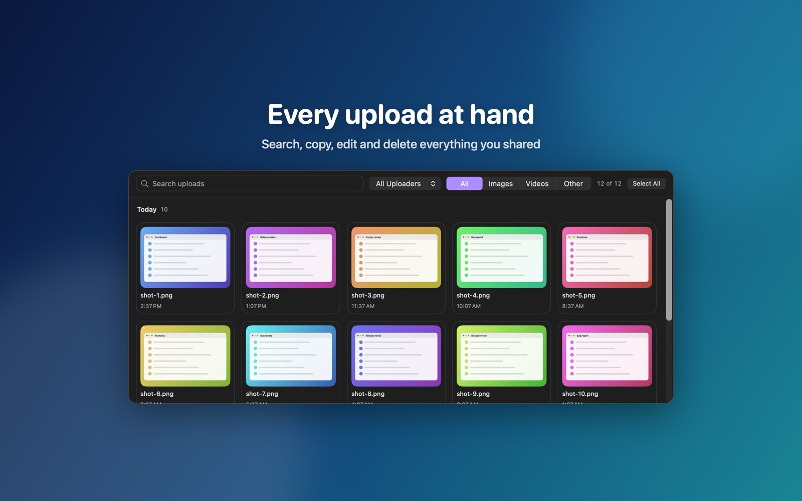

<p align="center">
  
</p>

<h1 align="center">ishare</h1>

<p align="center">The definitive screen capture utility for macOS, designed with simplicity and efficiency in mind.</p>

<p align="center">
  <a href="https://ishare.itoolio.dev">Website</a> ·
  <a href="https://apps.apple.com/app/ishare-screen-capture/id6499066314">Mac App Store</a> ·
  <a href="https://github.com/itoolio/ishare/releases/latest/download/ishare.dmg">Download DMG</a> ·
  <a href="https://crowdin.com/project/isharemac">Translate</a> ·
  <a href="https://discord.gg/sX4KYzu5pX">Discord</a>
</p>

<p align="center">
  <a href="https://github.com/itoolio/ishare/actions/workflows/release.yml"></a>
  <a href="https://github.com/itoolio/ishare/releases"></a>
  <a href="LICENSE"></a>
  <a href="https://github.com/sponsors/castdrian"></a>
</p>

```bash
brew install --cask ishare
```



<table>
  <tr>
    <td></td>
    <td></td>
  </tr>
  <tr>
    <td></td>
    <td></td>
  </tr>
</table>

## Features

- **Capture**: regions with a pixel magnifier, coordinates, colors and a measuring tool, windows with or without shadows, whole displays, your last region and scrolling pages, all through ScreenCaptureKit. Optional gradient backgrounds for window captures, privacy blur for chosen apps, text recognition, QR links, self-timer, interval capture and per-app profiles.
- **Record**: displays, windows or a region you draw, as video or GIF, with a webcam bubble, click and keystroke overlays, system audio and microphone meters, trimming, chapter markers, on-device captions and exports to MP4, MOV, GIF or audio.
- **Annotate**: arrows in several styles, lines, shapes, highlights, pen, marker, text, speech balloons, numbered steps, emoji and symbol stamps, magnifier, spotlight, blur, pixelate, smart eraser, crop with handles and aspect presets, rotate, flip, zoom and pan, a layers sidebar and templates. Done runs your after-capture actions.
- **Upload**: Imgur, custom HTTP uploaders, ShareX `.sxcu` import and S3-compatible storage (AWS S3, Cloudflare R2, DigitalOcean Spaces, Backblaze B2, MinIO) with expiring links and Keychain-stored secrets. Upload to several destinations, pick one per capture, upload text snippets, watch a folder, retry failed uploads, shorten links and redact sensitive text. Upload presets get their own shortcuts. An Apple Intelligence assistant builds uploaders from a conversation.
- **Automate**: global keyboard shortcuts, Shortcuts actions, a share menu extension, "Upload with ishare" in Finder and drag and drop onto the menu bar icon.
- **Everything else**: a customizable, keyboard-friendly menu with a ⌘K command palette and previews, a Recent Uploads widget, searchable upload history with server-side deletion, settings search and backup, sound options, a welcome guide, AirDrop, Photos, Messages and Mail sharing, 11 languages, and Liquid Glass on macOS 26.

## Custom uploaders

ishare imports `.iscu` files: JSON documents that describe an HTTP or S3 uploader. The full specification is on the [website](https://ishare.itoolio.dev/docs/iscu/), and ready-made uploaders for chibisafe, copyparty, Discord webhooks, lumen, Zipline and S3 are in [examples](examples).

## Development

The Xcode project is generated with [XcodeGen](https://github.com/yonaskolb/XcodeGen):

```bash
brew install xcodegen
xcodegen generate
open ishare.xcodeproj
```

- The `ishare` scheme builds the sandboxed App Store app, and the `GitHub` scheme builds the direct download app with Sparkle and runs the unit tests.
- The `UITests` scheme runs the menu, editor and upload flow UI tests against a deterministic test mode of the app; the upload flow captures a generated fixture image (`-ishareUITestCaptureSource fixture`, no screen recording permission needed), uploads it to a stub HTTP server the test starts on `127.0.0.1` and checks the toast, the clipboard and the history.
- Snapshot tests compare the menu, toast, editor toolbar and General settings with references in `ishareTests/Snapshots/macOS<major>/` and skip on macOS versions without references. Run the CI workflow manually with "record snapshots" to render the references on the macOS runner and commit them straight to `dev`.
- Release and maintenance tasks live in one Go CLI, `go run ./tools/cmd/ishare-tools <command>`:
  - `set-version <version>` writes the marketing version and build number to `Config.xcconfig`;
  - `release-notes [file]` turns release markdown on stdin into App Store release notes, merging several releases into one set of notes;
  - `release-check [--app ishare.app] [--release-notes file]` checks entitlements against `fastlane/entitlements-allowlist.json`, usage descriptions, the App Review notes in `fastlane/review_notes.txt`, the committed screenshots of every locale, the localized metadata and the release notes;
  - `metadata [--check]` renders the App Store listing (name, subtitle, keywords, promotional text, description and release notes) of every supported locale into `fastlane/metadata/<locale>/` from the `fastlane/metadata/Metadata.xcstrings` catalog, checking the App Store limits; release notes get localized section headings and keep English entries unless the catalog has a translation for them. Edit the English listing in the catalog, not in `fastlane/metadata/en-US`, and rerun the command;
  - `app-store-plan --report status.json --releases releases.json` decides whether to wait, submit or report a rejection from `fastlane mac status` and the GitHub releases;
  - `register-bundle-id [identifier...]` registers bundle identifiers with App Store Connect;
  - `merge-translations <base> <incoming> <output>` keeps only new Crowdin translations in a string catalog;
  - `screenshots [all | locale[:language]...]` renders the App Store screenshots through the `Screenshots` UI test scheme into `fastlane/screenshots` as 2880×1800 JPEGs. Run it on a Mac with a Retina display (the scenes are 1440×900 points) and commit the result, or pass `--ci` to create a 1680×1050 point HiDPI virtual display first (a CI-only helper in `tools/virtualdisplay`); the App Store workflow's "regenerate screenshots" option does that on a runner and commits the checked screenshots, including the website copies, straight to `dev`, so no extra branches are created. Releases upload the committed screenshots, and the App Store workflow replaces them on a version already in review.
- Releases are cut automatically from `main` with semantic-release, so use [Conventional Commits](https://www.conventionalcommits.org). Each release:
  - signs and notarizes the DMG;
  - updates the Sparkle appcast;
  - uploads the App Store build to App Store Connect and runs the release checklist.
- Submitting for review is decoupled from releases: the App Store Sync workflow runs after every release and every three hours. It always submits the newest processed release with the combined notes of every release since the live version, superseding an unsubmitted, rejected or still queued version (a submission waiting for review is withdrawn first, and kept until the newer build has finished processing); reviews that have started and approved versions awaiting release are never interrupted, and the job summary notes the pending release instead. It opens an "App Store rejected <version>" issue when a rejection has no newer release yet; the issue closes itself once that version is approved or superseded.
- Dependabot opens weekly, grouped pull requests against `dev` for GitHub Actions, the Go tools, the website and fastlane; minor and patch updates are squash-merged automatically once the required checks pass. Swift packages are declared in `project.yml` with up-to-next-major requirements and no committed `Package.resolved`, so every build already resolves their newest minor and patch versions; major versions are raised in `project.yml` by hand.
- Translations of the app (`ishare/Localizable.xcstrings`) and of the App Store listing (`fastlane/metadata/Metadata.xcstrings`) are managed on [Crowdin](https://crowdin.com/project/isharemac). Its pull requests are merged automatically, and every change to either catalog on `main` is uploaded back to Crowdin, sources and translations, by the Crowdin upload workflow.

## Contributors

[](https://github.com/itoolio/ishare/graphs/contributors)

## Credits

- [Inna Strazhnik](https://www.behance.net/strazhnik) for the original app icon

## License

Released under [GPL-3.0](LICENSE) by [@castdrian](https://github.com/castdrian).
